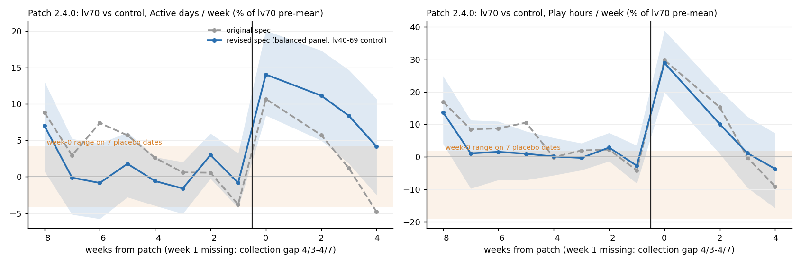
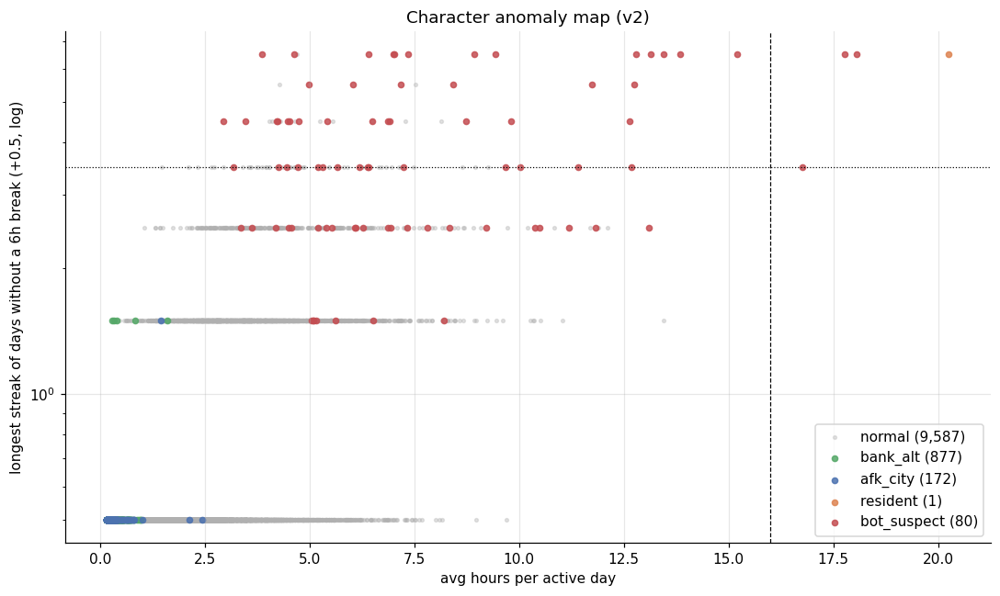
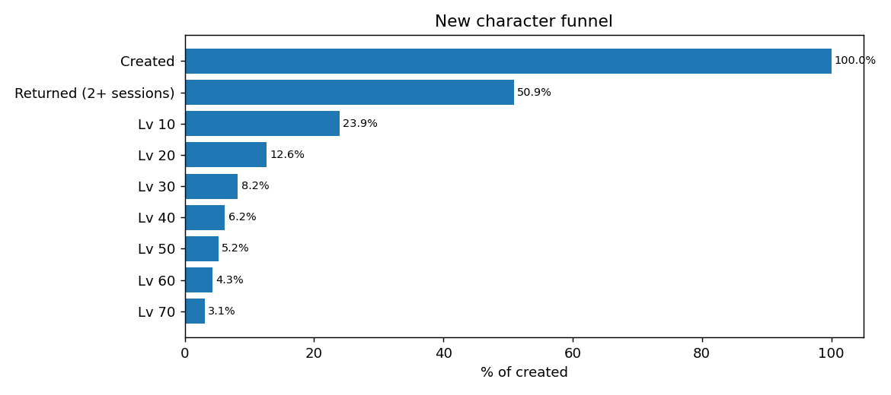
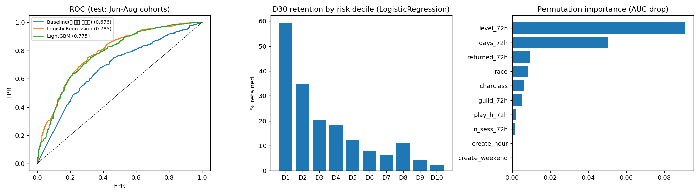
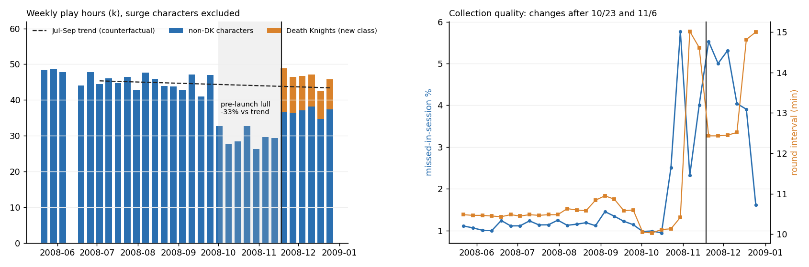

# WoW 플레이어 로그 분석: 데이터 품질 · 이상탐지 · 이탈 · 업데이트 효과

2008년 World of Warcraft 대만 서버의 1년치 접속 로그(1,082만 행)로 **데이터 품질 점검 → 이상 캐릭터 탐지 → 신규 유저 이탈 분석·예측 → 업데이트 효과의 인과 추정 → A/B 실험 설계**까지 진행한 프로젝트입니다.

이 프로젝트에서 가장 신경 쓴 것은 **처음 나온 숫자를 그대로 믿지 않는 것**입니다. 가짜 패치일(placebo) 검증, 수집 품질 점검, 교란 변수 통제를 거치며 처음에 냈던 결론 네 가지를 직접 수정했고, 그 과정도 함께 남겼습니다.

---

## 한눈에 보기

| 질문 | 방법 | 결과 |
|---|---|---|
| 데이터를 믿을 수 있나? | 중복·레벨 역행·종족 변경 점검, 수집 공백 측정 | 캐릭터 ID 충돌 1,221곳을 분리(37,354 ID → 38,575 캐릭터 생애), 기록 없는 1,061시간 식별 |
| 비정상 캐릭터는? | 행동 피처 + 규칙 기반 라벨링 | 10,717명 중 봇 의심 80명(4개 유형), 은행 캐릭터 877명, 마을 잠수 172명 분리 |
| 신규 유저는 어디서 떠나나? | 퍼널, 생존 곡선, 월별 코호트 | 49%가 첫 세션 후 미복귀, 전환율이 가장 낮은 단계는 Lv10 도달(47%) |
| 누가 떠날지 미리 알 수 있나? | 첫 72시간 행동 → 30일 이탈 예측, 시점 기준 학습/평가 분리 | 로지스틱 회귀 ROC-AUC 0.785 (기준선 0.676), 위험 상위 10% 잔존 2% vs 하위 10% 59% |
| 업데이트는 효과가 있었나? | 이중차분(DID), 단절 시계열(ITS), 가짜 패치일 7개 | 패치 2.4.0: 접속일 +14% → 약 3주 후 소멸 ("10주 지속" 결론 수정) |
| 실험으로 검증하려면? | A/B 설계, 표본 크기·기간 산출 | 복귀 유저 그룹당 약 1,500명 필요, 서버 10개 통합 시 약 15일 |

---

## 결론을 바로잡은 기록

| # | 처음 결론 | 무엇을 확인했나 | 수정된 결론 |
|---|---|---|---|
| 1 | 패치 2.4.0 효과가 10주 넘게 지속 | 패치 전 8주 동안 처치·대조 차이가 계속 줄어드는 **사전 추세**가 있었음. 원인은 "패치 직전 3주 접속자"로 그룹을 고른 선택 방식 | 사전 8주 매주 접속한 캐릭터로 패널을 고정하자 사전 추세가 사라짐. 실제 효과는 **접속 빈도 약 3주, 플레이 시간 약 2주** |
| 2 | 패치 3.0.3은 1주 만에 효과가 사라지는 "반짝 효과" | 점검 시간(15.5시간, 평소 약 9시간)과 신규 지역 첫 등장일로 **패치일을 다시 확인 → 실제로는 3.0.2**. 2주차에 특정 종족 관측 비중이 35% → 24%로 떨어지는 **수집 누락** 발견 | 복귀 유입은 1회성(1주차 +61~67%)이지만, DAU는 2주차에도 +1~+18% 남아 있을 가능성이 높음 |
| 3 | 확장팩(리치왕) 출시로 플레이 시간 +73% | 비교 기준으로 쓴 출시 직전 주가 **이례적인 공백기**(7~9월 대비 -33%)였음 | 7~9월 추세 대비로는 +12%. 증가분은 전부 신규 직업(데스나이트) 몫이고, 기존 직업은 오히려 추세보다 낮음 → **기존 유저의 갈아타기** 가능성 |
| 4 | 복귀 첫 주 길드 소속이면 정착 확률 2배 (오즈비 2.0) | 레벨·휴면 기간·첫 주 활동량을 통제한 로지스틱 회귀 | 통제 후 오즈비 1.0 → **레벨이 만든 교란**. 반면 첫 주 2일 이상 접속은 통제 후에도 오즈비 2.9로 유지 |


*회색 점선이 처음 분석, 파란 선이 보완 분석. 주황 띠는 가짜 패치일 7개에서 나온 값의 범위.*

---

## 데이터

- **출처:** [WoW Avatar History (WoWAH)](https://www.kaggle.com/datasets/mylesoneill/warcraft-avatar-history), 대만 서버
- **기간:** 2008-01-01 ~ 2008-12-31, 약 10분 간격 수집
- **규모:** 10,826,734행, 캐릭터 ID 37,354개
- **컬럼:** 캐릭터 ID, 레벨, 종족, 직업, 지역, 길드, 시각
- **한계:** 계정 ID·결제·노출 로그가 없음. 같은 사람의 다른 캐릭터를 묶을 수 없고, 실제 실험은 불가능해 설계와 기준값만 산출

원본 데이터는 저장소에 포함하지 않았습니다. 형식 확인용으로 `wowah_sample.csv`만 넣어 두었습니다.

---

## 1. 데이터 품질 점검

모든 분석의 바탕이 되는 단계입니다. 여기서 놓친 문제가 뒤의 결론을 여러 번 바꿨습니다.

- **캐릭터 ID 충돌:** 종족·직업이 바뀐 캐릭터 819명, 레벨이 떨어진 캐릭터 562명. 둘 다 해당하는 캐릭터가 423명으로 많이 겹쳐서, 하나의 ID를 여러 캐릭터가 나눠 쓴 것으로 판단 → 레벨이 크게 떨어지는 지점에서 분리 (1,221곳, 분석 단위 38,575개)
- **수집 공백:** 전체 8,784시간 중 기록이 없는 시간 1,061시간, 하루 전체가 빈 날 14일. 이후 분석은 **하루 20시간 이상 수집된 날**만 비교에 사용
- **10월 8~10일 신규 급증:** 3일 동안 신규 캐릭터 2,784개(비교 구간 128개). 하루만 보인 비율 73%, 처음부터 길드 소속 26%(비교 구간 5.5%), 같은 시기 사라진 기존 캐릭터의 28%가 종족·직업·길드·레벨로 신규와 매칭 → **실제 유입이 아니라 ID 재매핑 인공물**로 판단해 제외

---

## 2. 이상 캐릭터 탐지 (`wow.py`)

캐릭터별 행동 피처(총 플레이 시간, 최장 세션, 쉬는 구간 없는 날, 시간당 지역 이동, 전장 비율 등)를 만들고 규칙 기반으로 라벨링했습니다.

| 라벨 | 인원 | 특징 |
|---|---|---|
| 정상 | 9,587 | |
| 은행 캐릭터 | 877 | 성장·이동 없이 짧게 접속, 길드 없음 |
| 마을 잠수 | 172 | 도시에서 이동 없이 접속 유지 |
| 봇 의심 | 80 | 총 플레이 약 622시간, 최장 세션 약 27시간 (정상 약 60시간, 5.5시간) |
| 상주 캐릭터 | 1 | 1년 내내 접속, 성장 없음 (수집용 캐릭터 의심) |

- 봇 의심은 다시 **레벨링(33) / 전장 파밍(15) / 필드 파밍(3) / 기타(29)** 로 나눔
- v1 → v2에서 "24시간 이상 접속"을 **활동이 있는 세션**(지역 이동·레벨업)으로 한정해 잠수와 구분했고, v1 의심 목록과 비교해 유지·제외·신규를 따로 기록 (`anomaly_output_v2/B_dropped_from_v1.csv`, `B_new_in_v2.csv`)



---

## 3. 신규 유저 이탈 분석·예측 (`churn_project/`)

**대상:** 시작 지역에서 Lv1로 처음 등장하고 60일 이상 관측된 신규 캐릭터 7,040명
**이탈 정의:** 분석 종료일(2008-10-07, 10월 급증 이전) 기준 30일 이상 미접속

### 어디서 떠나나
- 첫 세션만 하고 돌아오지 않은 비율 **49.1%**
- 잔존율: D1 43.0% → D7 31.6% → D30 22.3% → D60 17.3%
- 레벨 퍼널에서 전환율이 가장 낮은 단계는 **Lv10 도달(47.0%)**



### 첫 72시간이 30일을 결정한다

| 첫 72시간 동안 | 30일 잔존율 |
|---|---|
| 1일만 접속 | 12.8% |
| 4일 모두 접속 | 70.2% |
| Lv1~3에 머묾 | 10.9% |
| Lv16 이상 도달 | 69.6% |

### 이탈 예측 모델
- **시점 기준 분리:** 6월 이전 생성 캐릭터(4,852명)로 학습, 이후(2,188명)로 평가. 무작위 분할보다 실제 운영 상황에 가까움
- 기준선(첫 세션 길이만) ROC-AUC 0.676 → **로지스틱 회귀 0.785**, LightGBM 0.775
- **더 어려운 조건으로 재평가 (`이탈분석.py`):** 성능이 "이미 안 돌아온 사람을 맞힌 것"에서만 나온 건 아닌지 확인하려고, 72시간 안에 다시 접속한 유저만으로 재학습 → AUC 0.730. 운영팀이 실제로 개입할 수 있는 집단에서도 예측력이 남아 있음
- 위험 점수 하위 10%는 개입 없이도 59%가 남고, 상위 10%는 2%만 남음 → **온보딩 개입은 중간 위험 구간이 대상**



### 추가 분석
- **여름 잔존 하락의 원인:** 봄 대비 여름 D30 잔존이 -5.2%p 하락. 72시간 행동 변화로는 거의 설명되지 않음(+0.5%p) → 초반 참여가 아니라 다른 요인
- **같은 시간을 해도 덜 성장하면 떠난다:** 72시간 플레이 1~2시간인 유저 중 레벨 하위 그룹 잔존 12.9%, 상위 그룹 29.2%
- **성장 막힘 구간 (step6):** Lv60은 통과 시간이 앞 레벨의 2.3배지만 경험치당 시간은 오히려 낮음 → 필요 경험치 증가 때문이며, 특정 직업에서만 막히는 구간은 없음

---

## 4. 업데이트 효과 분석 (`update_project/`)

| 이벤트 | 방법 | 결과 |
|---|---|---|
| 패치 2.4.0 (신규 콘텐츠) | 70레벨(처치) vs 40~69레벨(대조) 이중차분, 가짜 패치일 7개 | 접속일 +14% → +11% → +8% → 4주차 +4%(유의하지 않음). 0주·2주 효과는 가짜 날짜 7개 모두보다 큼 |
| 패치 3.0.2 (시스템) | 단절 시계열(사전 추세 + 요일 효과), 모형 4종 비교 | 복귀 유입은 1주차에 집중, DAU는 2주차에도 일부 유지 |
| 확장팩 리치왕 | 공백기 이전 추세 대비 효과, 직업별 분해 | 접속 캐릭터 +31%(출시 주), 플레이 시간 +12%. 데스나이트 제외 시 -17% |
| 복귀 유저 정착 | 로지스틱 회귀(780명, 2.3만 복귀 이벤트) | 첫 주 2일 이상 접속 오즈비 2.9(통제 후), 길드 효과는 레벨 교란 |

보완 분석 상세는 [`update_project/v2/README_v2.md`](update_project/v2/README_v2.md)에 정리했습니다.



---

## 5. A/B 실험 설계 (`update_project/ab_design.md`)

분석에서 얻은 "2일차 재접속 ↔ 장기 잔존" 관계는 관찰 결과일 뿐이라, 인과를 확인할 실험을 설계했습니다.

- **가설:** 복귀·신규 유저의 2일차 재접속을 유도하면 장기 잔존이 오른다
- **처치:** 첫날 로그아웃 시 "내일 접속 보상" 예고 + 이튿날 알림
- **지표:** 1차 2일차 재접속 / 가드레일 4~6주 잔존, 보상 수령 직후 이탈, 게임 내 경제
- **배정 단위:** 계정 (캐릭터 단위로 나누면 부캐 전환 시 오염)
- **표본:** 효과 +5%p 기준 그룹당 복귀 약 1,500명, 신규 약 800명. 서버 하나로는 91~151일 → **서버 10개 통합 시 약 15일**
- **장기 잔존을 1차 지표로 두지 않은 이유:** 2일차 재접속을 +5%p 올려도 4~6주 잔존은 약 +0.7%p만 오를 것으로 추정되고, 이를 검정하려면 그룹당 약 7.5만 명이 필요
- 사전 활동량 보정(CUPED)도 검토했으나 상관 0.12로 효과 미미(표본 1.5% 감소)

---

## 폴더 구조

```
├── wow_eda.py                 # 전체 EDA
├── wow.py                     # 이상 캐릭터 탐지 v2
├── 이탈자 확인.py              # 신규 캐릭터 이탈 퍼널 (초기 버전 → funnel_output/)
├── 이탈분석.py                 # 이탈 예측 재평가 (재접속 유저만)
├── wowah_sample.csv           # 데이터 샘플
├── eda_output/                # EDA 결과
├── anomaly_output/            # 이상탐지 v1 결과
├── anomaly_output_v2/         # 이상탐지 v2 결과
├── funnel_output/             # 이탈 퍼널 초기 버전 결과
├── churn_project/             # 이탈 분석 step1~6 (정제 → 코호트 → 퍼널 → 예측 → 원인 → 막힘 구간)
└── update_project/            # 업데이트 효과 분석
    └── v2/                    # 보완 분석 (결론 수정)
```
<!-- TODO: churn_project step1~5 스크립트 추가 필요 -->

## 실행

```bash
pip install pandas numpy matplotlib scikit-learn lightgbm pyarrow
```

1. Kaggle에서 데이터를 내려받아 이 폴더에 `wowah_data.csv`, `zones.csv`, `locations.csv`, `location_coords.csv`를 둡니다.
2. 각 스크립트 상단의 `DATA_DIR`을 본인 경로로 바꿉니다.
3. `update_project/` 스크립트는 이 폴더에서 `python update_project/<스크립트>.py`로 실행합니다 (`churn_project/step6/clean.pkl` 필요).

## 기술 스택

Python · pandas · NumPy · scikit-learn · LightGBM · matplotlib
분석 기법: 이중차분(DID), 단절 시계열(ITS), 가짜 패치일 검증(placebo), 로지스틱 회귀(교란 통제), 생존·코호트 분석, 퍼널 분석, 검정력 분석
